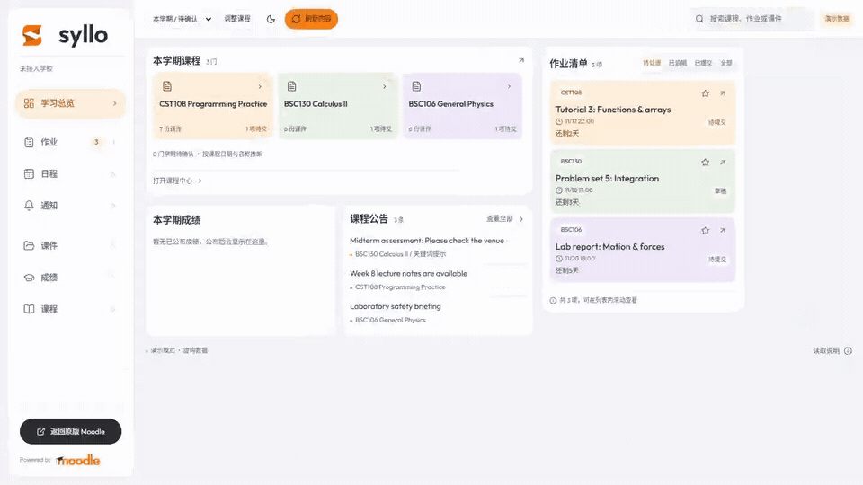
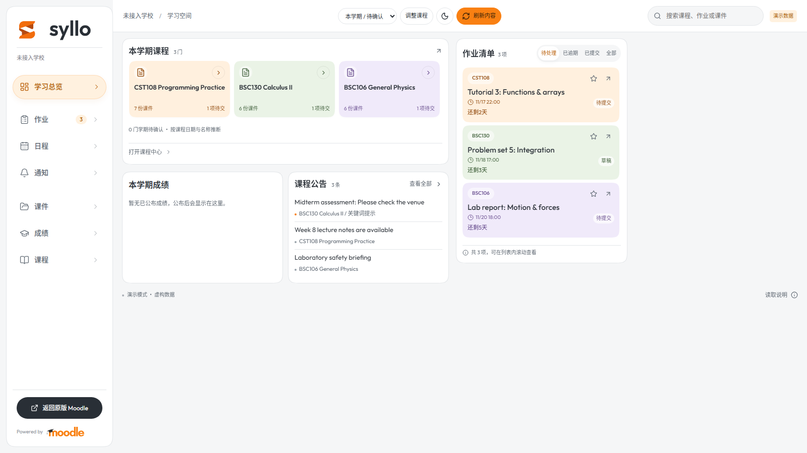
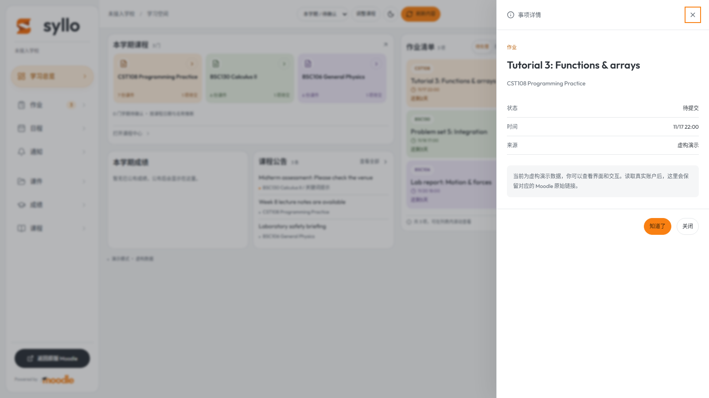
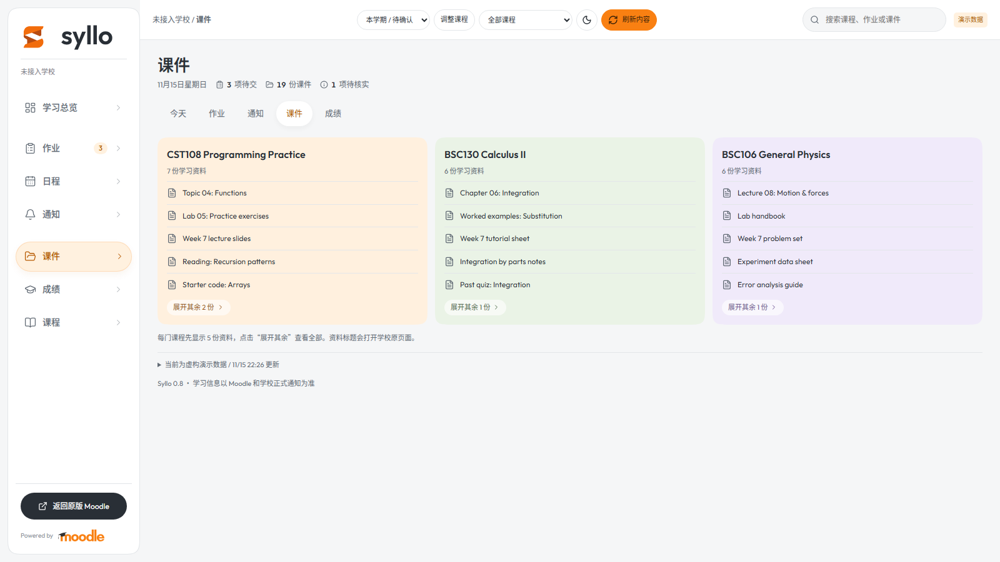
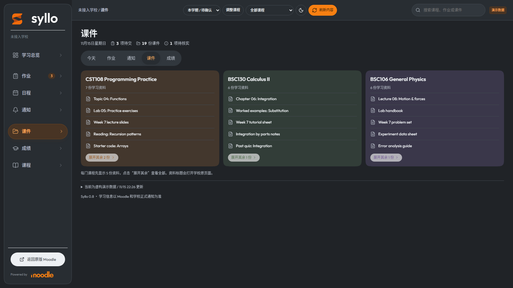
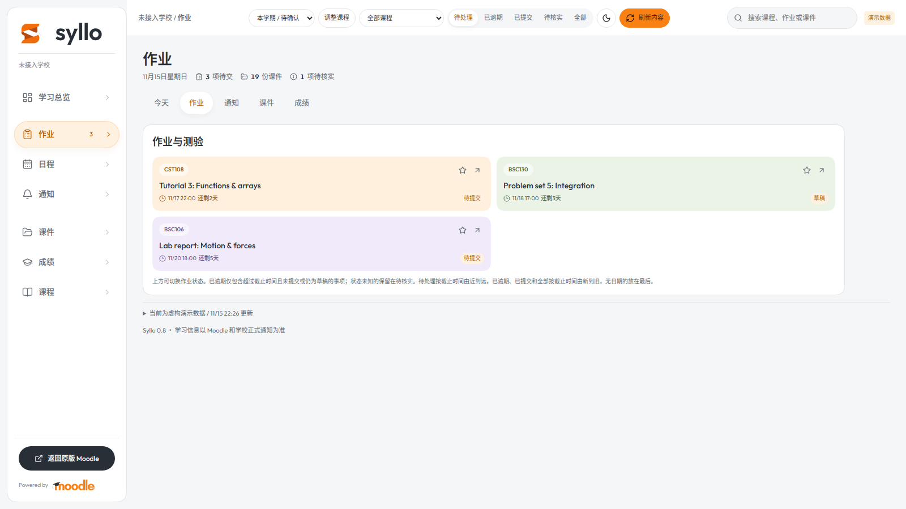
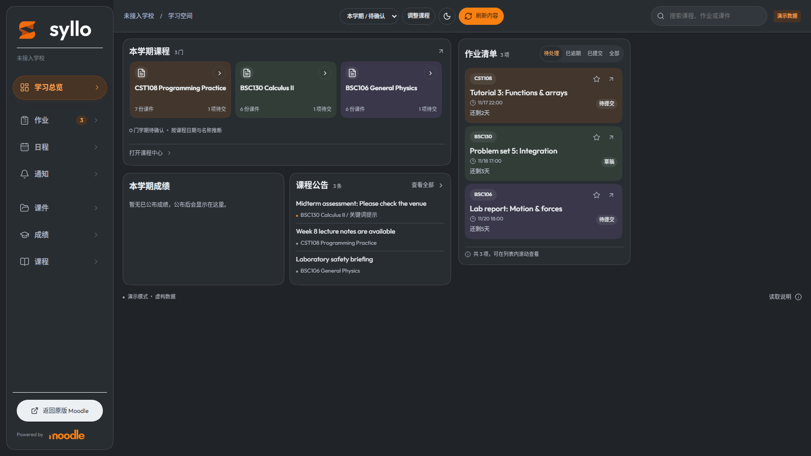
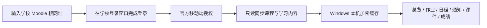

<p align="center">
  
</p>

<h1 align="center">Syllo</h1>

<p align="center">把分散在 Moodle 里的课程、作业、课件、公告、成绩和日程，收进一张 Windows 学习桌面。</p>

<p align="center">
  <strong>简体中文</strong> ·
  <a href="docs/locales/README.en.md">English</a> ·
  <a href="docs/locales/README.ms.md">Bahasa Melayu</a> ·
  <a href="docs/locales/README.zh-TW.md">繁體中文</a> ·
  <a href="docs/locales/README.ja.md">日本語</a>
</p>

<p align="center">
  <a href="https://github.com/chenbinghan666/syllo/releases/latest"><strong>下载 Windows 版</strong></a> ·
  <a href="docs/USER-GUIDE.md">中文使用说明</a> ·
  <a href="PRIVACY.md">隐私说明</a>
</p>

<p align="center">
  <a href="https://github.com/chenbinghan666/syllo/releases/latest"></a>
  <a href="https://github.com/chenbinghan666/syllo/actions/workflows/tests.yml"></a>
  
  <a href="LICENSE"></a>
</p>

> Syllo 是独立个人项目，不是学校或 Moodle 官方产品。当前完整验证环境为 XMUM；其他学校能否使用，取决于其 Moodle 是否开放官方移动端接口。

## 实际操作演示

[](docs/images/syllo-demo.mp4)

上方是一次连续录屏，不是截图轮播；点击可播放清晰 MP4。画面内课程、作业、公告与成绩均为虚构数据。

<table>
  <tr>
    <td width="50%"><br><b>学习总览</b>：课程、作业与公告放在同一页。</td>
    <td width="50%"><br><b>事项详情</b>：保留状态、时间、来源和 Moodle 原链接。</td>
  </tr>
  <tr>
    <td width="50%"><br><b>课件</b>：按课程整理资源、文件夹和活动。</td>
    <td width="50%"><br><b>深色模式</b>：同一信息层级，不换一套操作逻辑。</td>
  </tr>
  <tr>
    <td width="50%"><br><b>作业列表</b>：在待处理、逾期、已提交与全部记录间切换。</td>
    <td width="50%"><br><b>深色总览</b>：桌面端完整布局，不是移动端裁切图。</td>
  </tr>
</table>

所有截图均来自项目自带的虚构演示页，不含真实账号、成绩或学校记录。

## 从学校登录到学习桌面



账号密码只在学校自己的登录页输入。Syllo 不保存密码，也不会自动提交作业、参加测验或修改成绩。

## 能做什么

| 模块 | Syllo 整理的内容 | 边界 |
| --- | --- | --- |
| **学习总览** | 本学期课程、待处理作业、公告和已公布成绩 | 学期归属在缺少日期时会基于课程名与访问记录推断 |
| **作业** | 截止时间、草稿、逾期、已提交和团队提交状态 | 最终状态以 Moodle 原页面为准 |
| **课件与课程** | 资源、文件夹、活动链接、课程封面和完整课程名称 | Turnitin、Mediasite 等外部插件可能只能打开原页 |
| **公告与通知** | 课程公告、个人通知与重要提示 | 接口未开放时会显示读取说明，不把失败伪装成“没有消息” |
| **成绩与测验** | 已公布的成绩项目、测验和原始评分细节 | 不预测、不补全未公布成绩 |
| **日程** | Moodle 日历活动、作业与测验日期 | 只显示接口返回的范围，不代替学校正式通知 |

## 下载与安装

前往 [最新 Release](https://github.com/chenbinghan666/syllo/releases/latest)，二选一：

| 文件 | 适合谁 | 用法 |
| --- | --- | --- |
| `Syllo-Setup-v0.8.0.exe` | 希望有桌面和开始菜单快捷方式 | 双击安装，不需要管理员权限 |
| `Syllo-Windows-x64-v0.8.0.zip` | 不想安装或要放在移动硬盘 | 完整解压后运行 `Syllo.exe`，不能只复制单个 EXE |

当前安装包没有商业代码签名，Windows SmartScreen 可能显示“未知发布者”。请只从本仓库 Release 下载，并用 Release 内的 SHA-256 核对文件；详细步骤见 [中文使用说明](docs/USER-GUIDE.md)。

## 第一次连接

1. 输入学校 Moodle 根网址，例如 XMUM 为 `https://l.xmu.edu.my`。
2. 在学校自己的登录窗口完成账号、验证码或单点登录。
3. 登录成功后，Syllo 通过 Moodle 官方移动端授权读取当前账号可访问的内容。
4. 选择“在这台电脑上记住登录”时，授权信息使用 Windows 本机加密保存。

不同学校的 Moodle 插件、权限和接口配置并不相同。Syllo 会先检查公开能力；不满足条件时停止并说明原因，不尝试绕过学校限制。

## 隐私与安全边界

- **不保存 Moodle 密码**：密码只进入学校登录页。
- **只读接口**：预设调用不会提交作业、答题或修改成绩。
- **本机加密**：保存的授权和学习快照按 Windows 用户加密，并按学校与账号隔离。
- **缓存可控**：退出连接会删除该连接的授权与学习缓存；卸载应用不会自动删除 `%APPDATA%\Syllo`。
- **原页优先**：需要查看完整要求或执行操作时，使用短期单次网页登录凭据回到 Moodle 原页面。
- **不上传遥测**：当前版本没有自建账号、云同步或分析遥测服务。

完整说明见 [PRIVACY.md](PRIVACY.md)。分享日志或截图前，请移除姓名、学号、课程成员、成绩和私人路径。

## 缓存与刷新

Syllo 启动时先显示最近一次加密快照，再按缓存时间决定是否刷新。课程结构可复用 6 小时，课程封面可复用 24 小时；作业提交状态不会使用这类长缓存。“刷新内容”会绕过接口缓存读取最新结果。读取任务最多 4 路并行，单个模块失败不会抹掉其他已成功内容。

## 兼容性

- Windows 10 / 11 x64
- 当前完整验证：XMUM Moodle
- 需要学校启用 Moodle 官方移动端服务及相关 Web Service
- 学校禁用接口、插件内容只存在于附件、或活动由外部平台托管时，可能只能读取部分元信息
- 安装包与便携版当前均未代码签名

如果你在其他学校测试，欢迎在 [Issues](https://github.com/chenbinghan666/syllo/issues) 中写明 Moodle 版本、学校是否启用官方 App，以及失败页面的去身份化截图。不要上传 token、Cookie、完整日志或真实成绩。

## 从源码运行

项目使用原生 JavaScript + Electron，没有运行时 npm 依赖。Windows 打包脚本会校验已经下载的官方 Electron 压缩包 SHA-256，再复制本地应用文件。

```powershell
python -m http.server 8765 --bind 127.0.0.1
# 浏览器打开 http://127.0.0.1:8765/ 查看虚构数据演示

python tools/build_desktop.py
python tools/package_windows.py
```

主要目录：

```text
desktop/          Electron 主进程、授权、Moodle API、缓存与窗口生命周期
docs/             使用说明、多语言主页与演示素材
tests/            API 语义、缓存隔离、窗口生命周期和浏览器界面测试
tools/            站点能力检查、桌面构建与 Windows 打包
board.js          界面结构与交互
theme.js          单一视觉系统
semesters.js      学期识别与手动覆盖逻辑
```

## 测试

```powershell
node tests/api-tests.cjs
node tests/sync-cache-tests.cjs
node tests/window-lifecycle-tests.cjs
```

仓库的回归数据均为虚构或去身份化数据。测试覆盖提交语义、团队状态、成绩细节、公告分页、个人通知、部分失败、账号隔离缓存、并发上限和窗口重建。通过离线测试不能替代不同学校 Moodle 配置下的真实兼容性验证。

## 版本与翻译

版本记录见 [CHANGELOG.md](CHANGELOG.md)。多语言 README 为机器翻译，已核对结构、链接、命令与关键术语，但没有经过各语言母语者逐条审校。

## 许可证与声明

原创代码与文档使用 [MIT License](LICENSE)。字体、图标、Electron、Moodle 标志及其他第三方组件遵循各自许可证，详见 [assets/README.md](assets/README.md) 与 [NOTICE.md](NOTICE.md)。Moodle 名称与标志属于其各自权利人；本项目与 Moodle、XMUM 或任何学校均无隶属或官方合作关系。
