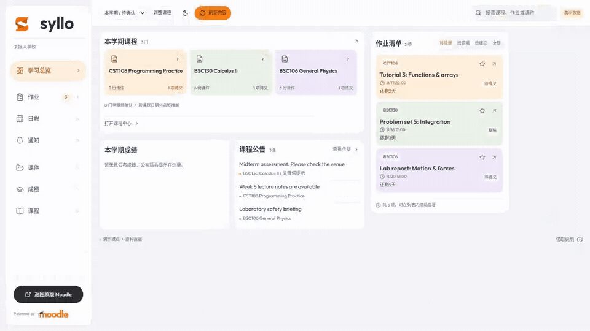
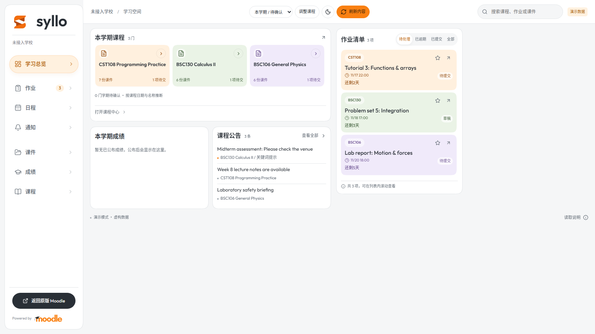
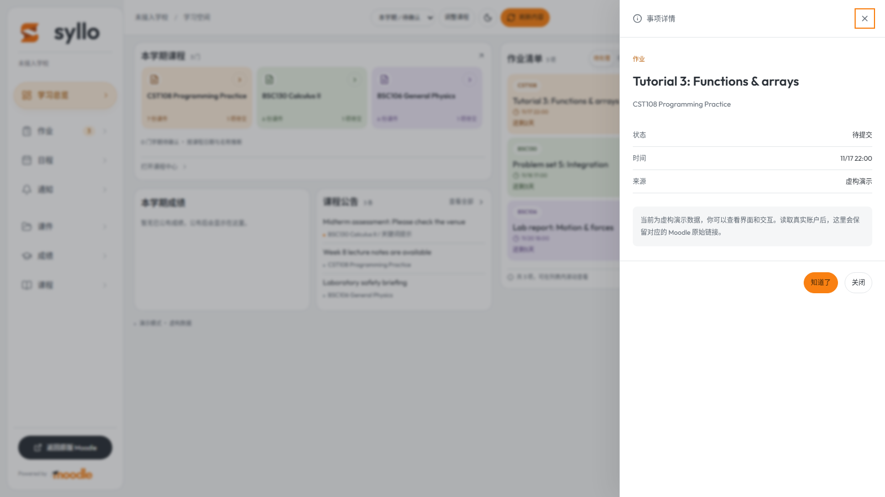
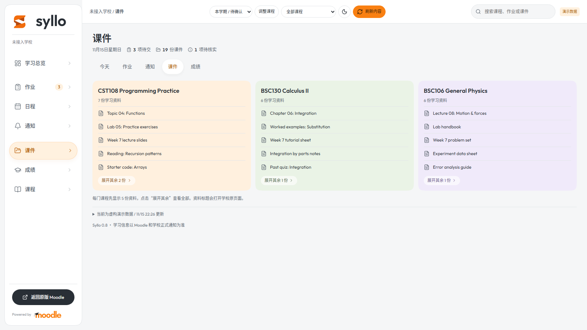
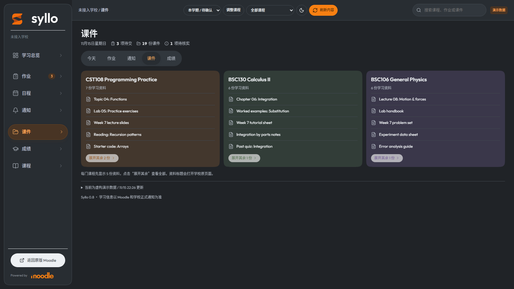
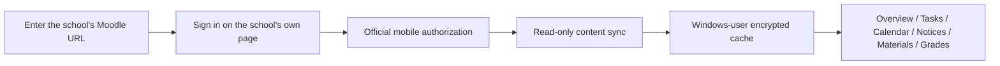

<p align="center"></p>
<h1 align="center">Syllo</h1>
<p align="center">Bring Moodle courses, assignments, materials, notices, grades and dates into one Windows study desktop.</p>

<p align="center">
  <a href="../../README.md">简体中文</a> · <strong>English</strong> ·
  <a href="README.ms.md">Bahasa Melayu</a> ·
  <a href="README.zh-TW.md">繁體中文</a> ·
  <a href="README.ja.md">日本語</a>
</p>

<p align="center">
  <a href="https://github.com/chenbinghan666/syllo/releases/latest"><strong>Download for Windows</strong></a> ·
  <a href="../../PRIVACY.md">Privacy notes</a>
</p>

> Syllo is an independent personal project, not an official school or Moodle product. Full validation currently covers XMUM; support at another school depends on its Moodle mobile services and Web Service configuration.

## Real interaction demo

[](../images/syllo-demo.mp4)

This is a continuous recording, not a slideshow. Click it for the clearer MP4. Every course, assignment, notice and grade shown is fictional.

<table>
  <tr>
    <td width="50%"><br><b>Overview</b>: courses, assignments and notices on one page.</td>
    <td width="50%"><br><b>Item details</b>: status, time, source and the original Moodle link.</td>
  </tr>
  <tr>
    <td width="50%"><br><b>Materials</b>: resources, folders and activities grouped by course.</td>
    <td width="50%"><br><b>Dark mode</b>: the same hierarchy and controls in a darker palette.</td>
  </tr>
</table>

## How the connection works



The Moodle password is entered only on the school's login page. Syllo does not store it, submit assignments, answer quizzes or edit grades.

## What it organizes

| Area | Content | Boundary |
| --- | --- | --- |
| **Overview** | Current courses, pending work, notices and published grades | When dates are missing, term membership may be inferred from course names and recent access |
| **Assignments** | Due dates, drafts, overdue, submitted and team states | The original Moodle page remains authoritative |
| **Materials and courses** | Resources, folders, activity links, covers and full course names | External plugins such as Turnitin or Mediasite may only expose an original-page link |
| **Notices** | Course announcements, personal notifications and important messages | A failed or unavailable endpoint is reported instead of being presented as an empty inbox |
| **Grades and quizzes** | Published grade items, quizzes and available raw grading details | Unpublished grades are never guessed |
| **Calendar** | Moodle events, assignment dates and quiz dates | It only shows the range returned by Moodle and does not replace official school notices |

## Download and install

Open the [latest Release](https://github.com/chenbinghan666/syllo/releases/latest):

| File | Use |
| --- | --- |
| `Syllo-Setup-v0.8.0.exe` | Recommended installer; creates Desktop and Start Menu shortcuts without requiring administrator rights |
| `Syllo-Windows-x64-v0.8.0.zip` | Portable build; extract the complete folder, then run `Syllo.exe` |

The current binaries are not commercially code-signed, so Windows SmartScreen may show an unknown-publisher warning. Download only from this repository and verify the SHA-256 values in the Release.

## First connection

1. Enter the Moodle root URL. XMUM uses `https://l.xmu.edu.my`.
2. Complete the account, CAPTCHA or SSO flow in the school's own login window.
3. Syllo uses Moodle's official mobile authorization to read content available to that account.
4. If “remember this login” is selected, authorization is encrypted for the current Windows user.

Schools expose different plugins, permissions and APIs. Syllo checks public capabilities first and explains an unsupported setup instead of bypassing school restrictions.

## Privacy boundaries

- Moodle passwords are not stored.
- Preset API calls are read-only and cannot submit work or change grades.
- Saved authorization and learning snapshots are encrypted for the current Windows user and separated by school and account.
- Disconnecting removes that connection's authorization and cache; uninstalling does not automatically remove `%APPDATA%\Syllo`.
- Where supported, original pages open through Moodle's short-lived, single-use web-login interface.
- v0.8.0 has no Syllo account system, cloud sync, ads or analytics telemetry.

See [PRIVACY.md](../../PRIVACY.md) for details. Remove names, student IDs, course members, grades, tokens, cookies and private paths before sharing a screenshot or log.

## Compatibility and limits

- Windows 10 / 11 x64
- Fully validated environment: XMUM Moodle
- The school must enable Moodle mobile services and the relevant Web Services
- External activities and schedules stored only in attachments may expose limited metadata
- The installer and portable build are currently unsigned

Reports from other schools are welcome in [Issues](https://github.com/chenbinghan666/syllo/issues). Include the Moodle version and a de-identified screenshot, but never upload tokens, cookies, full logs or real grades.

## Build and test

Syllo uses plain JavaScript and Electron with no runtime npm dependencies.

```powershell
python -m http.server 8765 --bind 127.0.0.1
# Open http://127.0.0.1:8765/ for the fictional browser demo

python tools/build_desktop.py
python tools/package_windows.py

node tests/api-tests.cjs
node tests/sync-cache-tests.cjs
node tests/window-lifecycle-tests.cjs
```

Regression data is fictional or de-identified. Offline tests cover API semantics, team submission, grade details, pagination, personal notifications, partial failures, account-isolated caches, concurrency and window recreation; they do not replace testing against each school's Moodle configuration.

## License and translation

Original code and documentation are released under the [MIT License](../../LICENSE). Third-party fonts, icons, Electron, the Moodle logo and other components retain their own licenses; see [NOTICE.md](../../NOTICE.md). Syllo is not affiliated with Moodle, XMUM or any school.

This translation was machine-generated and checked for structure, links, commands and key terminology, but has not received line-by-line native-speaker review.
