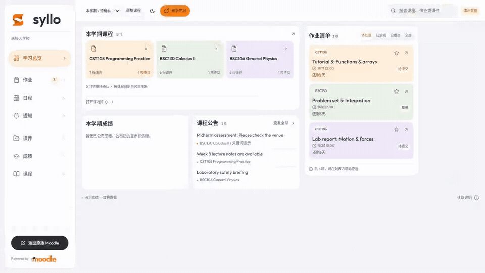
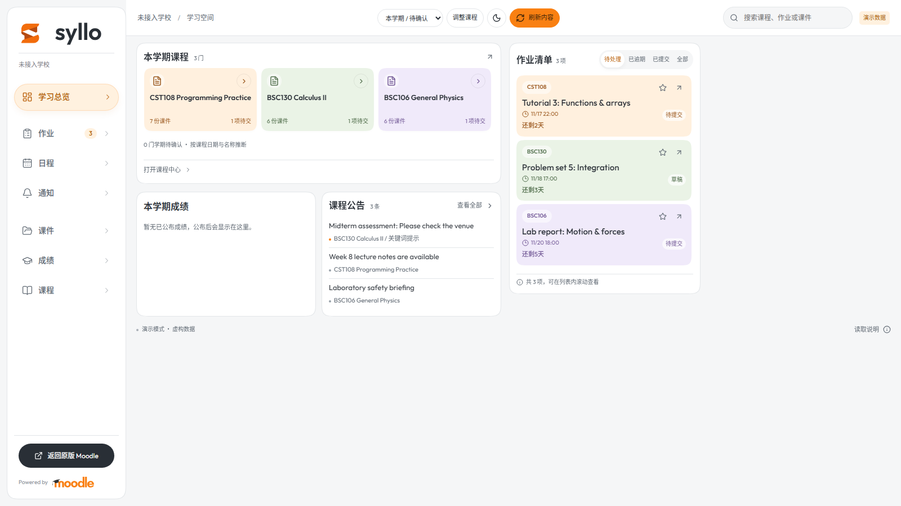
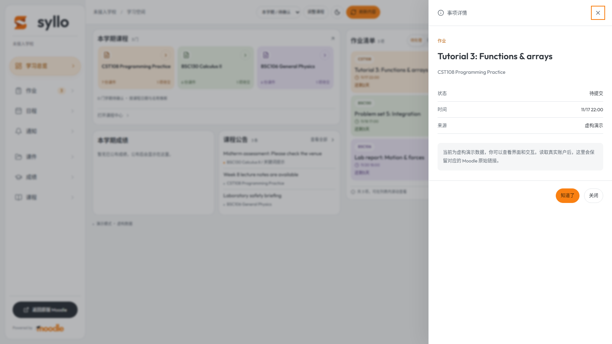
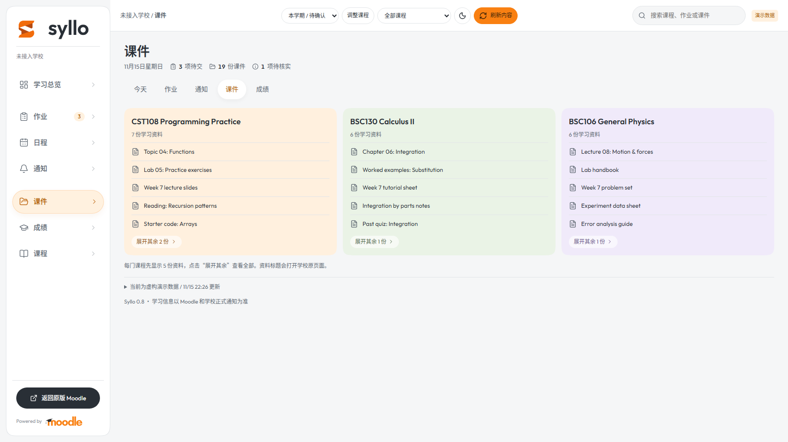
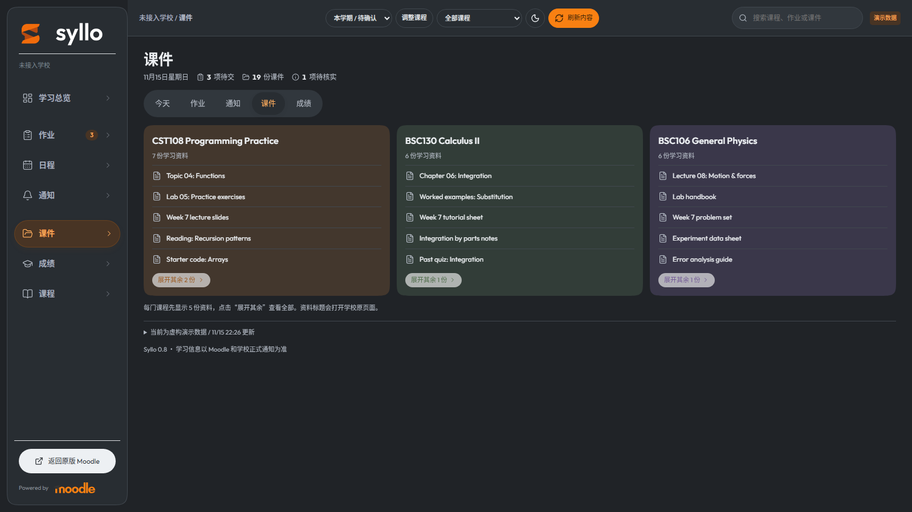
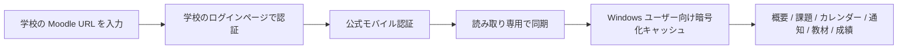

<p align="center"></p>
<h1 align="center">Syllo</h1>
<p align="center">Moodle のコース、課題、教材、お知らせ、成績、予定を、1つの Windows 学習デスクトップにまとめます。</p>

<p align="center">
  <a href="../../README.md">简体中文</a> · <a href="README.en.md">English</a> ·
  <a href="README.ms.md">Bahasa Melayu</a> · <a href="README.zh-TW.md">繁體中文</a> ·
  <strong>日本語</strong>
</p>

<p align="center"><a href="https://github.com/chenbinghan666/syllo/releases/latest"><strong>Windows 版をダウンロード</strong></a> · <a href="../../PRIVACY.md">プライバシー情報</a></p>

> Syllo は独立した個人プロジェクトであり、学校や Moodle の公式製品ではありません。現在、完全な検証環境は XMUM です。他校での利用可否は、その学校の Moodle モバイルサービスと Web Service 設定に依存します。

## 実際の操作デモ

[](../images/syllo-demo.mp4)

上は静止画のスライドショーではなく、連続した操作録画です。クリックすると高画質の MP4 を再生できます。画面内のコース、課題、お知らせ、成績はすべて架空データです。

<table>
  <tr>
    <td width="50%"><br><b>学習概要</b>：コース、課題、お知らせを1ページに集約。</td>
    <td width="50%"><br><b>項目詳細</b>：状態、時刻、出典、Moodle 原ページへのリンクを表示。</td>
  </tr>
  <tr>
    <td width="50%"><br><b>教材</b>：リソース、フォルダー、アクティビティをコース別に整理。</td>
    <td width="50%"><br><b>ダークモード</b>：同じ情報階層と操作を暗色テーマで提供。</td>
  </tr>
</table>

## 接続の流れ



Moodle のパスワードは学校のログインページにのみ入力します。Syllo はパスワードを保存せず、課題提出、クイズ回答、成績変更を行いません。

## 整理できる内容

| 画面 | 内容 | 制限 |
| --- | --- | --- |
| **学習概要** | 今学期のコース、未完了課題、お知らせ、公開済み成績 | 日付がない場合、コース名と最近のアクセスから学期を推定することがあります |
| **課題** | 期限、下書き、期限超過、提出済み、チーム提出状態 | 最終的な状態は Moodle 原ページを確認してください |
| **教材とコース** | リソース、フォルダー、活動リンク、カバー、完全なコース名 | Turnitin や Mediasite などは原ページのリンクのみ取得できる場合があります |
| **お知らせ** | コース告知、個人通知、重要メッセージ | API が利用できない場合、空欄にせず読み取りエラーを表示します |
| **成績とクイズ** | 公開済み成績項目、クイズ、取得可能な採点詳細 | 未公開の成績を推測しません |
| **カレンダー** | Moodle イベント、課題・クイズの日付 | Moodle が返す範囲のみを表示し、学校の正式通知には代わりません |

## ダウンロードとインストール

[最新 Release](https://github.com/chenbinghan666/syllo/releases/latest) を開いてください。

| ファイル | 用途 |
| --- | --- |
| `Syllo-Setup-v0.8.0.exe` | 推奨インストーラー。管理者権限なしでデスクトップとスタートメニューにショートカットを作成 |
| `Syllo-Windows-x64-v0.8.0.zip` | ポータブル版。フォルダー全体を展開して `Syllo.exe` を実行 |

現在のバイナリには商用コード署名がないため、Windows SmartScreen が「不明な発行元」と表示する場合があります。このリポジトリの Release からのみダウンロードし、SHA-256 を確認してください。

## 初回接続

1. Moodle のルート URL を入力します。XMUM は `https://l.xmu.edu.my` です。
2. 学校のログインウィンドウで、アカウント、CAPTCHA、SSO を完了します。
3. Syllo は Moodle 公式モバイル認証を使い、そのアカウントがアクセスできる内容を読み取ります。
4. 「このログインを記憶」を選ぶと、認証情報は現在の Windows ユーザー向けに暗号化されます。

学校ごとにプラグイン、権限、API 設定は異なります。Syllo は公開機能を先に確認し、非対応の場合は理由を表示します。学校の制限を回避しません。

## プライバシー境界

- Moodle のパスワードを保存しません。
- 既定の API 呼び出しは読み取り専用で、提出や成績変更はできません。
- 保存した認証と学習スナップショットは Windows ユーザー向けに暗号化し、学校・アカウントごとに分離します。
- 接続解除でその接続の認証とキャッシュを削除します。アンインストールだけでは `%APPDATA%\Syllo` は自動削除されません。
- 学校が対応する場合、Moodle の短時間・1回限りの Web ログインで原ページを開きます。
- v0.8.0 には Syllo アカウント、クラウド同期、広告、解析テレメトリはありません。

詳細は [PRIVACY.md](../../PRIVACY.md) を参照してください。スクリーンショットやログを共有する前に、氏名、学籍番号、履修者、成績、トークン、Cookie、個人パスを削除してください。

## 対応環境と制限

- Windows 10 / 11 x64
- 現在の完全検証環境：XMUM Moodle
- 学校側で Moodle モバイルサービスと関連 Web Service が有効である必要があります
- 外部アクティビティや添付ファイル内だけの時間割は、取得できる情報が限定される場合があります
- インストーラーとポータブル版は現在未署名です

他校での結果は [Issues](https://github.com/chenbinghan666/syllo/issues) へお寄せください。Moodle のバージョンと匿名化した画像は歓迎しますが、トークン、Cookie、完全なログ、実際の成績は投稿しないでください。

## ビルドとテスト

Syllo はプレーン JavaScript と Electron を使用し、実行時 npm 依存関係はありません。

```powershell
python -m http.server 8765 --bind 127.0.0.1
python tools/build_desktop.py
python tools/package_windows.py

node tests/api-tests.cjs
node tests/sync-cache-tests.cjs
node tests/window-lifecycle-tests.cjs
```

回帰データは架空または匿名化済みです。オフラインテストは、各学校の Moodle 設定に対する実機検証の代わりにはなりません。

## ライセンスと翻訳

オリジナルのコードと文書は [MIT License](../../LICENSE) です。フォント、アイコン、Electron、Moodle ロゴなどの第三者コンポーネントには各ライセンスが適用されます。詳しくは [NOTICE.md](../../NOTICE.md) を参照してください。Syllo は Moodle、XMUM、その他の学校と提携していません。

この翻訳は機械生成で、構造、リンク、コマンド、主要用語を確認済みですが、母語話者による逐語レビューは行っていません。
