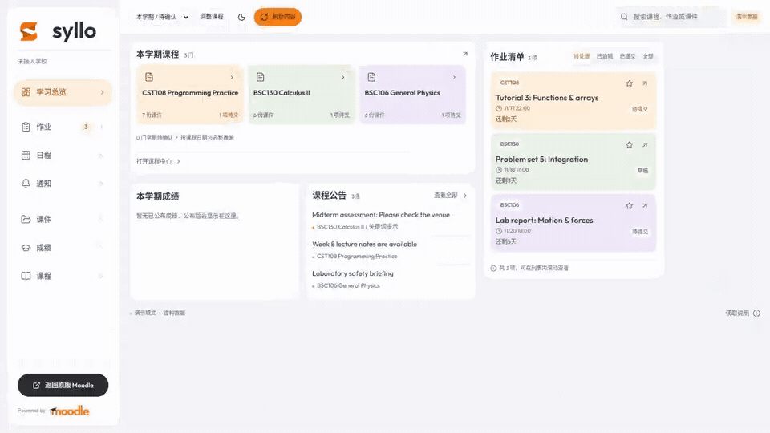
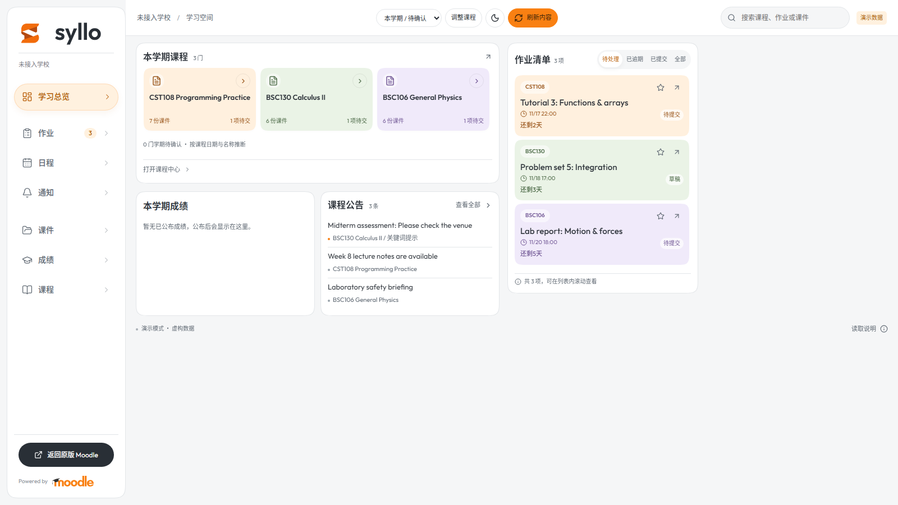
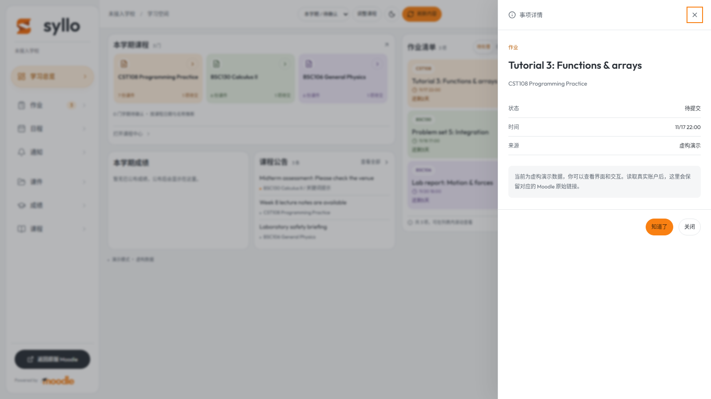
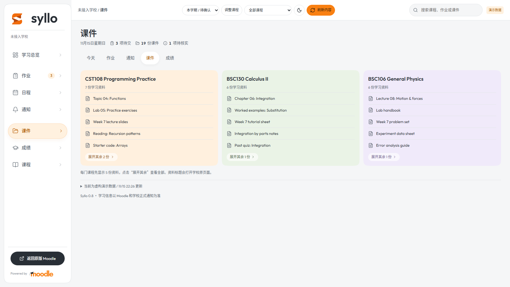
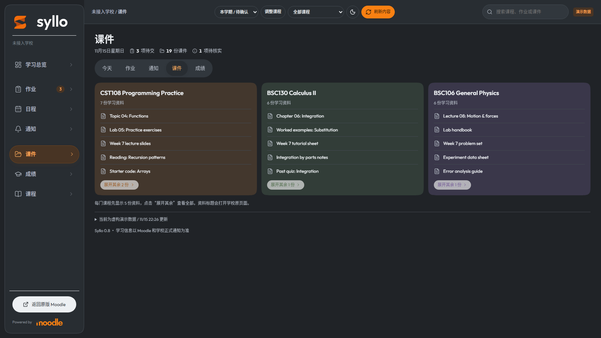
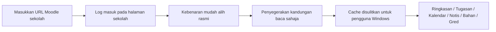

<p align="center"></p>
<h1 align="center">Syllo</h1>
<p align="center">Satukan kursus, tugasan, bahan, pengumuman, gred dan tarikh Moodle dalam satu ruang pembelajaran Windows.</p>

<p align="center">
  <a href="../../README.md">简体中文</a> · <a href="README.en.md">English</a> ·
  <strong>Bahasa Melayu</strong> · <a href="README.zh-TW.md">繁體中文</a> ·
  <a href="README.ja.md">日本語</a>
</p>

<p align="center"><a href="https://github.com/chenbinghan666/syllo/releases/latest"><strong>Muat turun untuk Windows</strong></a> · <a href="../../PRIVACY.md">Nota privasi</a></p>

> Syllo ialah projek peribadi bebas, bukan produk rasmi sekolah atau Moodle. Pengesahan penuh setakat ini meliputi XMUM; sokongan di sekolah lain bergantung pada perkhidmatan mudah alih dan konfigurasi Web Service Moodle sekolah tersebut.

## Demo interaksi sebenar

[](../images/syllo-demo.mp4)

Ini ialah rakaman berterusan, bukan tayangan slaid. Klik untuk MP4 yang lebih jelas. Semua kursus, tugasan, pengumuman dan gred dalam rakaman ialah data rekaan.

<table>
  <tr>
    <td width="50%"><br><b>Gambaran keseluruhan</b>: kursus, tugasan dan pengumuman pada satu halaman.</td>
    <td width="50%"><br><b>Butiran item</b>: status, masa, sumber dan pautan asal Moodle.</td>
  </tr>
  <tr>
    <td width="50%"><br><b>Bahan</b>: sumber, folder dan aktiviti disusun mengikut kursus.</td>
    <td width="50%"><br><b>Mod gelap</b>: hierarki dan kawalan yang sama dalam palet gelap.</td>
  </tr>
</table>

## Cara sambungan berfungsi



Kata laluan Moodle hanya dimasukkan pada halaman log masuk sekolah. Syllo tidak menyimpannya, menghantar tugasan, menjawab kuiz atau mengubah gred.

## Kandungan yang disusun

| Bahagian | Kandungan | Had |
| --- | --- | --- |
| **Ringkasan** | Kursus semasa, tugasan belum selesai, notis dan gred yang diterbitkan | Jika tarikh tiada, semester mungkin dianggarkan daripada nama kursus dan akses terkini |
| **Tugasan** | Tarikh akhir, draf, lewat, dihantar dan status kumpulan | Halaman asal Moodle kekal sebagai rujukan muktamad |
| **Bahan dan kursus** | Sumber, folder, pautan aktiviti, kulit kursus dan nama penuh | Pemalam luar seperti Turnitin atau Mediasite mungkin hanya menyediakan pautan asal |
| **Notis** | Pengumuman kursus, pemberitahuan peribadi dan mesej penting | Kegagalan API dilaporkan, bukan dipaparkan sebagai peti masuk kosong |
| **Gred dan kuiz** | Item gred yang diterbitkan, kuiz dan butiran pemarkahan yang tersedia | Gred yang belum diterbitkan tidak diteka |
| **Kalendar** | Acara Moodle, tarikh tugasan dan kuiz | Hanya julat yang diberikan Moodle dipaparkan |

## Muat turun dan pasang

Buka [Release terkini](https://github.com/chenbinghan666/syllo/releases/latest):

| Fail | Kegunaan |
| --- | --- |
| `Syllo-Setup-v0.8.0.exe` | Pemasang yang disyorkan; mencipta pintasan Desktop dan Start Menu tanpa hak pentadbir |
| `Syllo-Windows-x64-v0.8.0.zip` | Versi mudah alih; ekstrak keseluruhan folder, kemudian jalankan `Syllo.exe` |

Binari semasa belum ditandatangani secara komersial, jadi Windows SmartScreen mungkin memaparkan amaran penerbit tidak dikenali. Muat turun hanya daripada Release repositori ini dan semak nilai SHA-256.

## Sambungan pertama

1. Masukkan URL akar Moodle. XMUM menggunakan `https://l.xmu.edu.my`.
2. Lengkapkan akaun, CAPTCHA atau SSO dalam tetingkap log masuk sekolah.
3. Syllo menggunakan kebenaran mudah alih rasmi Moodle untuk membaca kandungan yang boleh dicapai oleh akaun tersebut.
4. Jika “ingat log masuk ini” dipilih, maklumat kebenaran disulitkan untuk pengguna Windows semasa.

Setiap sekolah mendedahkan pemalam, kebenaran dan API yang berbeza. Syllo menyemak keupayaan awam dahulu dan menerangkan konfigurasi yang tidak disokong tanpa memintas sekatan sekolah.

## Batas privasi

- Kata laluan Moodle tidak disimpan.
- Panggilan API pratetap adalah baca sahaja dan tidak boleh menghantar kerja atau mengubah gred.
- Kebenaran dan snapshot pembelajaran disulitkan untuk pengguna Windows semasa serta diasingkan mengikut sekolah dan akaun.
- Memutuskan sambungan memadam kebenaran dan cache sambungan itu; menyahpasang aplikasi tidak memadam `%APPDATA%\Syllo` secara automatik.
- Jika disokong, halaman asal dibuka melalui log masuk web sekali guna dan berjangka pendek Moodle.
- v0.8.0 tidak mempunyai akaun Syllo, penyegerakan awan, iklan atau telemetri analitik.

Lihat [PRIVACY.md](../../PRIVACY.md). Padam nama, nombor pelajar, ahli kursus, gred, token, kuki dan laluan peribadi sebelum berkongsi tangkap layar atau log.

## Keserasian dan had

- Windows 10 / 11 x64
- Persekitaran yang diuji sepenuhnya: XMUM Moodle
- Sekolah perlu mengaktifkan perkhidmatan mudah alih Moodle dan Web Service berkaitan
- Aktiviti luaran dan jadual yang hanya disimpan dalam lampiran mungkin memberikan metadata terhad
- Pemasang dan versi mudah alih belum ditandatangani

Laporan daripada sekolah lain dialu-alukan di [Issues](https://github.com/chenbinghan666/syllo/issues). Sertakan versi Moodle dan tangkap layar yang dinyahkenal pasti; jangan muat naik token, kuki, log penuh atau gred sebenar.

## Bina dan uji

Syllo menggunakan JavaScript biasa dan Electron tanpa kebergantungan npm masa jalan.

```powershell
python -m http.server 8765 --bind 127.0.0.1
python tools/build_desktop.py
python tools/package_windows.py

node tests/api-tests.cjs
node tests/sync-cache-tests.cjs
node tests/window-lifecycle-tests.cjs
```

Data regresi adalah rekaan atau dinyahkenal pasti. Ujian luar talian tidak menggantikan ujian terhadap konfigurasi Moodle setiap sekolah.

## Lesen dan terjemahan

Kod dan dokumentasi asal menggunakan [Lesen MIT](../../LICENSE). Fon, ikon, Electron, logo Moodle dan komponen pihak ketiga mengekalkan lesen masing-masing; lihat [NOTICE.md](../../NOTICE.md). Syllo tidak mempunyai hubungan rasmi dengan Moodle, XMUM atau mana-mana sekolah.

Terjemahan ini dijana mesin dan telah disemak untuk struktur, pautan, arahan dan istilah utama, tetapi belum disemak baris demi baris oleh penutur asli.
