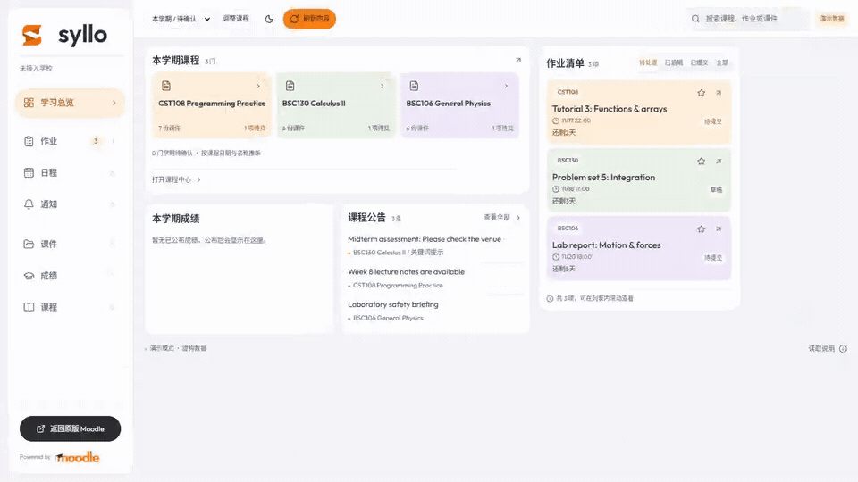
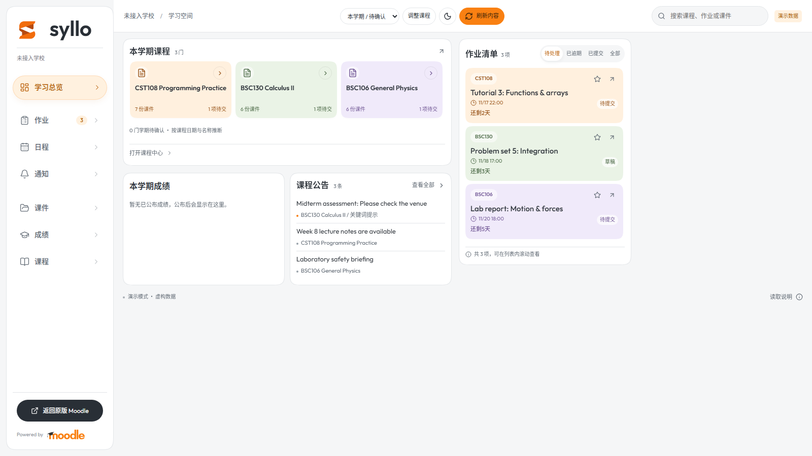
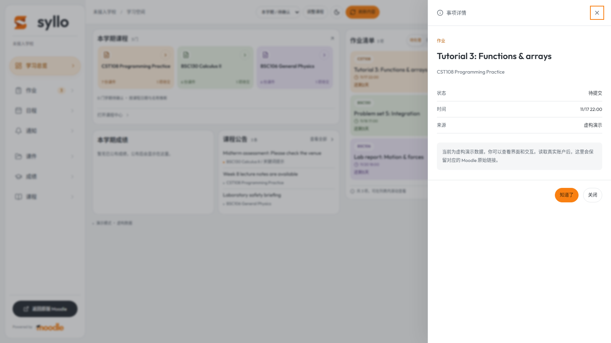
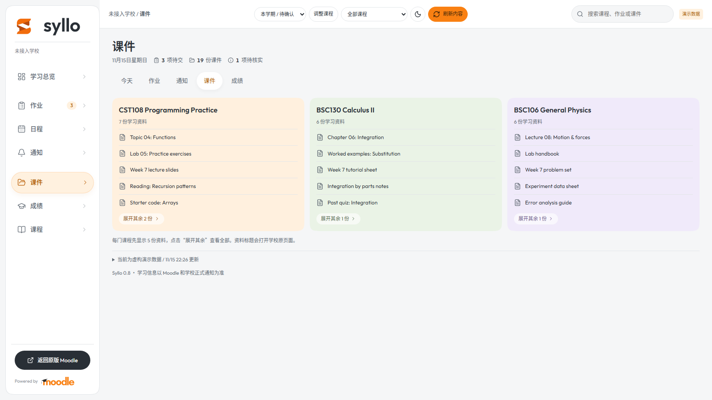
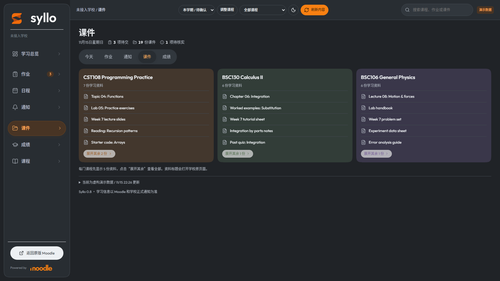
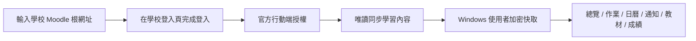

<p align="center"></p>
<h1 align="center">Syllo</h1>
<p align="center">把散落在 Moodle 裡的課程、作業、教材、公告、成績與日期，收進同一張 Windows 學習桌面。</p>

<p align="center">
  <a href="../../README.md">简体中文</a> · <a href="README.en.md">English</a> ·
  <a href="README.ms.md">Bahasa Melayu</a> · <strong>繁體中文</strong> ·
  <a href="README.ja.md">日本語</a>
</p>

<p align="center"><a href="https://github.com/chenbinghan666/syllo/releases/latest"><strong>下載 Windows 版</strong></a> · <a href="../../PRIVACY.md">隱私說明</a></p>

> Syllo 是獨立個人專案，不是學校或 Moodle 官方產品。目前完整驗證環境為 XMUM；其他學校能否使用，取決於該校 Moodle 是否開放官方行動服務與相關 Web Service。

## 實際操作示範

[](../images/syllo-demo.mp4)

上方是一次連續錄影，不是截圖輪播；點擊可播放較清晰的 MP4。畫面中的課程、作業、公告與成績全部是虛構資料。

<table>
  <tr>
    <td width="50%"><br><b>學習總覽</b>：課程、作業與公告放在同一頁。</td>
    <td width="50%"><br><b>事項詳情</b>：保留狀態、時間、來源和 Moodle 原始連結。</td>
  </tr>
  <tr>
    <td width="50%"><br><b>教材</b>：依課程整理資源、資料夾和活動。</td>
    <td width="50%"><br><b>深色模式</b>：同一套資訊層級與操作邏輯。</td>
  </tr>
</table>

## 連線方式



Moodle 密碼只會輸入學校自己的登入頁。Syllo 不儲存密碼，也不會自動提交作業、參加測驗或修改成績。

## 能整理什麼

| 模組 | 內容 | 邊界 |
| --- | --- | --- |
| **學習總覽** | 本學期課程、待處理作業、公告與已公布成績 | 缺少日期時，可能依課程名稱與近期存取推斷學期 |
| **作業** | 截止時間、草稿、逾期、已提交與團隊狀態 | 最終狀態以 Moodle 原始頁面為準 |
| **教材與課程** | 資源、資料夾、活動連結、封面與完整課名 | Turnitin、Mediasite 等外部外掛可能只能開啟原頁 |
| **公告與通知** | 課程公告、個人通知與重要提示 | 介面不可用時會顯示讀取說明，不把失敗顯示成空白 |
| **成績與測驗** | 已公布成績項目、測驗與可取得的評分細節 | 不猜測未公布成績 |
| **日曆** | Moodle 活動、作業與測驗日期 | 只顯示 Moodle 回傳範圍，不取代學校正式通知 |

## 下載與安裝

前往 [最新 Release](https://github.com/chenbinghan666/syllo/releases/latest)：

| 檔案 | 用法 |
| --- | --- |
| `Syllo-Setup-v0.8.0.exe` | 建議使用；建立桌面與開始功能表捷徑，不需要系統管理員權限 |
| `Syllo-Windows-x64-v0.8.0.zip` | 可攜版；完整解壓縮後執行 `Syllo.exe` |

目前執行檔沒有商業程式碼簽章，Windows SmartScreen 可能顯示未知發行者。請只從本倉庫 Release 下載，並核對 SHA-256。

## 第一次連線

1. 輸入 Moodle 根網址；XMUM 使用 `https://l.xmu.edu.my`。
2. 在學校登入視窗完成帳號、驗證碼或 SSO。
3. Syllo 透過 Moodle 官方行動端授權讀取目前帳號可存取的內容。
4. 選擇「記住登入」時，授權資料會針對目前 Windows 使用者加密。

各校的外掛、權限與 API 設定不一。Syllo 會先檢查公開能力；不支援時說明原因，不繞過學校限制。

## 隱私邊界

- 不儲存 Moodle 密碼。
- 預設 API 呼叫為唯讀，不提交作業或變更成績。
- 授權與學習快照會針對目前 Windows 使用者加密，並依學校與帳號隔離。
- 中斷連線會刪除該連線的授權與快取；解除安裝不會自動刪除 `%APPDATA%\Syllo`。
- 學校支援時，原始頁面透過 Moodle 的短效單次網頁登入介面開啟。
- v0.8.0 沒有 Syllo 帳號、雲端同步、廣告或分析遙測。

詳見 [PRIVACY.md](../../PRIVACY.md)。分享截圖或日誌前，請移除姓名、學號、課程成員、成績、token、Cookie 與私人路徑。

## 相容性與限制

- Windows 10 / 11 x64
- 目前完整驗證：XMUM Moodle
- 學校需啟用 Moodle 官方行動服務與相關 Web Service
- 外部活動與只存在附件中的課表可能只能讀取部分中繼資料
- 安裝版與可攜版目前均未簽章

歡迎其他學校在 [Issues](https://github.com/chenbinghan666/syllo/issues) 回報 Moodle 版本與去識別化截圖。請勿上傳 token、Cookie、完整日誌或真實成績。

## 建置與測試

Syllo 使用原生 JavaScript 與 Electron，沒有執行階段 npm 相依套件。

```powershell
python -m http.server 8765 --bind 127.0.0.1
python tools/build_desktop.py
python tools/package_windows.py

node tests/api-tests.cjs
node tests/sync-cache-tests.cjs
node tests/window-lifecycle-tests.cjs
```

回歸資料均為虛構或去識別化資料。離線測試不能取代針對各校 Moodle 設定的實際驗證。

## 授權與翻譯

原創程式碼與文件使用 [MIT License](../../LICENSE)。字型、圖示、Electron、Moodle 標誌與其他第三方元件沿用各自授權，詳見 [NOTICE.md](../../NOTICE.md)。Syllo 與 Moodle、XMUM 或任何學校均無隸屬或官方合作關係。

本翻譯由機器產生，已檢查結構、連結、指令與關鍵術語，但未經母語者逐行審校。
